# The Tideman Voting Algorithm: A Deep Dive Into Computational Democracy

*How I transformed a simple CS50 assignment into a comprehensive exploration of voting theory, graph algorithms, and democratic decision-making*

---

## 🌟 The Journey Begins: From Assignment to Research Project

Picture this: you're working through Harvard's CS50 problem sets, and you encounter something called the "Tideman voting algorithm." At first glance, it seems like just another programming exercise involving arrays and loops. But then you start reading about the underlying theory, and suddenly you're tumbling down a rabbit hole of democratic theory, graph algorithms, and computational social choice.

That's exactly what happened to me.

### 🎯 The Spark of Curiosity

What started as a straightforward assignment quickly became something much more fascinating. The Tideman algorithm wasn't just about coding—it was about answering one of humanity's most fundamental questions: **How do we make fair decisions as a group?**

I found myself asking deeper questions:
- Why do different voting methods produce different winners?
- What happens when there's no clear "best" candidate?
- How do we handle voting paradoxes that seem to break logic itself?
- Can we build systems that are both fair and computationally efficient?

### 🚀 The Challenge I Set Myself

The original CS50 problem was elegant but limited: implement the basic Tideman algorithm with about 200 lines of code. But I wanted to push further:

> **"What if I could build a professional-grade voting analysis platform that demonstrates deep understanding of both computer science and political theory?"**

This ambitious goal led me to:
- Implement multiple voting methods for comparison
- Add comprehensive statistical analysis and simulation
- Create professional visualizations and user interfaces
- Optimize algorithms for performance
- Build a complete research-quality system (1,300+ lines)

The result? A project that showcases not just programming skills, but interdisciplinary thinking that bridges computer science, mathematics, and political theory.

## 🗳️ The Tideman Method: Democracy Meets Graph Theory

### 🤔 Why Simple Voting Falls Short

Let me tell you a story about a student council election that perfectly illustrates why voting is way more complicated than it first appears.

Imagine we're running an election for student body president with three candidates: **Alice**, **Bob**, and **Charlie**. We have 9 students voting, and here's how they rank their preferences:

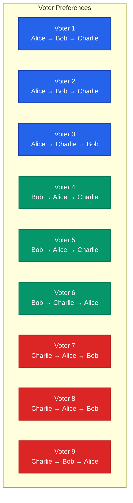

Now, if we use **simple plurality voting** (just count first-place votes):

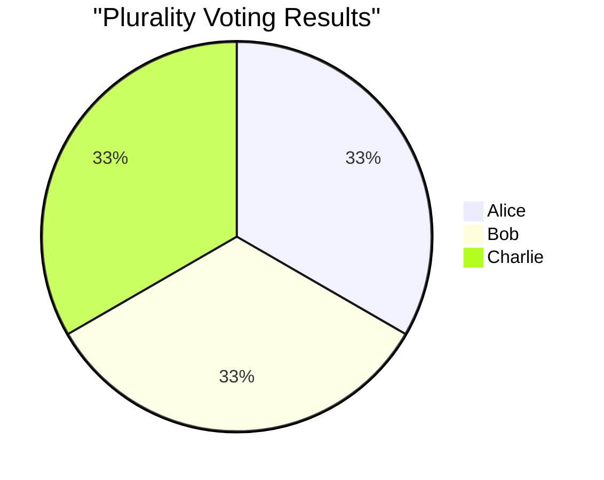

**Result: A perfect three-way tie!** 😱

But wait—this can't be the whole story. Surely the voters' second and third choices matter too? This is where things get really interesting...

### 🔍 The Power of Head-to-Head Analysis

Here's where it gets fascinating. What if instead of just looking at first choices, we examine how each candidate performs against every other candidate in direct matchups? Let's dive deep into the pairwise comparisons:

#### Alice vs Bob Showdown
Let's carefully count who prefers Alice over Bob:
- **Voters 1, 2, 3**: All rank Alice first, Bob second → Alice wins
- **Voters 7, 8**: Rank Alice second, Bob third → Alice wins  
- **Total for Alice**: 5 voters

Who prefers Bob over Alice?
- **Voters 4, 5**: Rank Bob first, Alice second → Bob wins
- **Voters 6, 9**: Rank Bob higher than Alice → Bob wins
- **Total for Bob**: 4 voters

**Result: Alice beats Bob 5-4** ✅

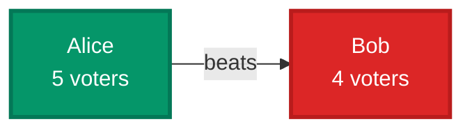

#### Alice vs Charlie Battle
- **Alice supporters**: Voters 1, 2, 4, 5, 6 = **5 voters**
- **Charlie supporters**: Voters 3, 7, 8, 9 = **4 voters**

**Result: Alice beats Charlie 5-4** ✅

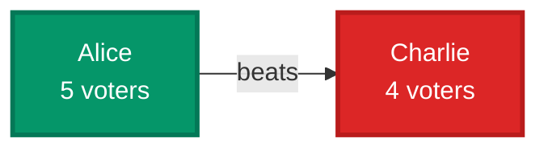

#### Bob vs Charlie Clash
- **Bob supporters**: Voters 1, 2, 4, 5 = **4 voters**
- **Charlie supporters**: Voters 3, 6, 7, 8, 9 = **5 voters**

**Result: Charlie beats Bob 5-4** ✅

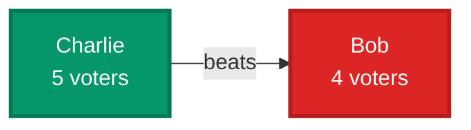

### 🏆 The Condorcet Winner Emerges

When we map out all the relationships, something beautiful emerges:

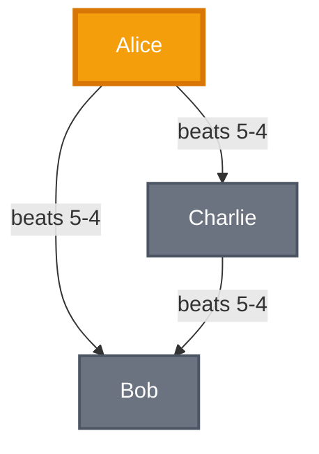

**Alice is the Condorcet winner!** She beats every other candidate in direct head-to-head comparisons. Even though the plurality vote was a tie, Alice is clearly the candidate that the most voters prefer when compared to any alternative.

This is the key insight: **the Condorcet winner is the candidate who would win every possible two-way race.**

But here's the million-dollar question: How do we systematically find this winner when we have complex preference patterns? And what happens when there *isn't* a clear Condorcet winner?

### 🧠 Enter the Tideman Algorithm: Elegance in Three Steps

The Tideman algorithm is like a masterful conductor orchestrating a complex symphony of voter preferences. It works through three beautifully interconnected steps that transform messy voting data into a clear winner. Let me walk you through each step:

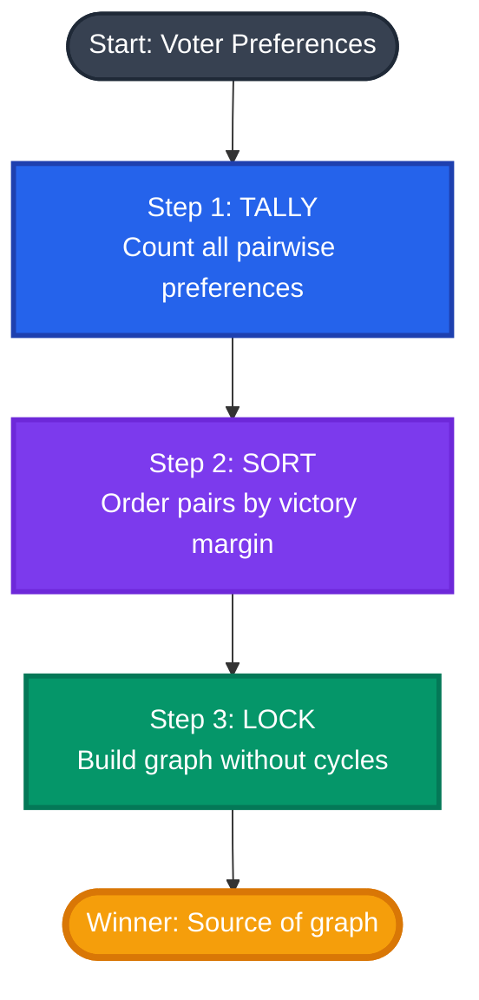

#### 🔢 Step 1: TALLY - Building the Preference Matrix

First, we systematically count every pairwise preference. Think of this as creating a "battle record" for each candidate pair:

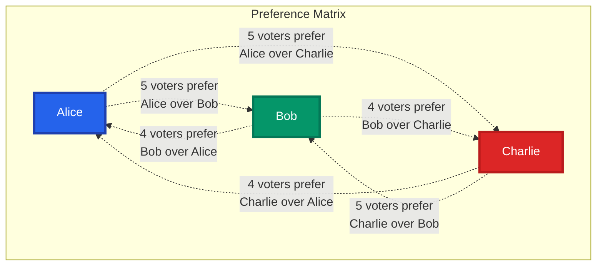

This creates our preference matrix:
```
         Alice  Bob  Charlie
Alice      -     5      5
Bob        4     -      4  
Charlie    4     5      -
```

#### 📊 Step 2: SORT - Ranking by Victory Strength

Next, we identify all victories and sort them by margin strength. This is crucial because stronger preferences should take priority:

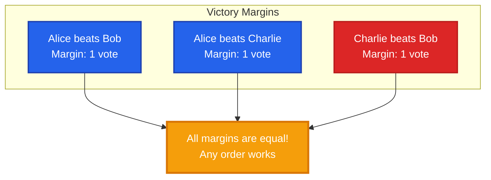

In this case, all margins are equal (1 vote each), so any ordering works. But imagine if Alice beat Bob by 10 votes while other margins were smaller—we'd prioritize that stronger preference.

#### 🔒 Step 3: LOCK - The Critical Graph-Building Phase

This is where the magic happens! We build a directed graph by "locking in" edges one by one, but with one crucial rule: **never create a cycle**.

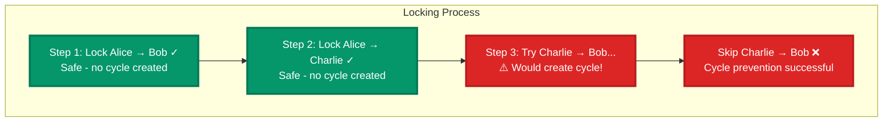

Let's visualize why that third edge would be problematic:

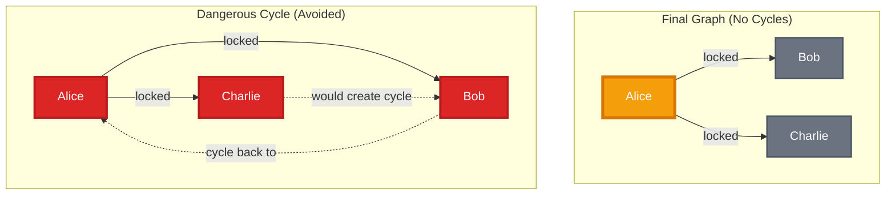

**Winner Identification**: Alice is the "source" of our graph—she has no arrows pointing toward her, meaning no one definitively beats her in our locked preference structure.

The beauty of this approach? It guarantees that if a Condorcet winner exists, the Tideman method will find them. And if no Condorcet winner exists (due to voting cycles), it breaks the tie in a principled way by prioritizing stronger preferences.

## 🌪️ When Democracy Goes Haywire: The Condorcet Paradox

Now, let me blow your mind with one of the most fascinating problems in voting theory. What happens when the collective will of the people... doesn't make logical sense?

### 🎭 The Setup: A Perfectly Logical Paradox

Imagine a different election scenario with the same three candidates, but with a perfectly symmetrical voter distribution:

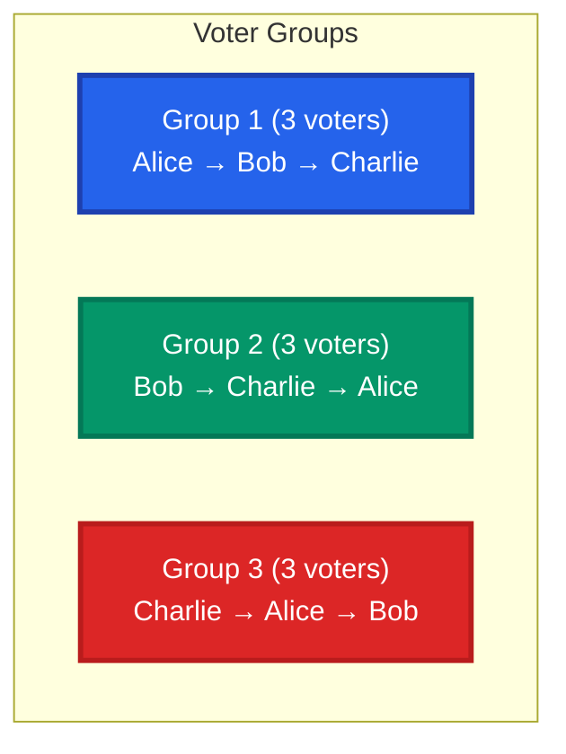

At first glance, this seems perfectly reasonable. Each group has clear, rational preferences. But when we analyze the head-to-head matchups, something mind-bending happens:

### 🔍 The Head-to-Head Analysis

Let's count the votes carefully:

**Alice vs Bob:**
- Group 1: Prefers Alice (3 votes)
- Group 2: Prefers Bob (3 votes)  
- Group 3: Prefers Alice (3 votes)
- **Result: Alice beats Bob 6-3** ✅

**Bob vs Charlie:**
- Group 1: Prefers Bob (3 votes)
- Group 2: Prefers Bob (3 votes)
- Group 3: Prefers Charlie (3 votes)  
- **Result: Bob beats Charlie 6-3** ✅

**Charlie vs Alice:**
- Group 1: Prefers Alice... wait, no! Prefers Charlie? Let me recalculate...
- Group 1: Alice > Bob > Charlie, so prefers Alice (3 votes)
- Group 2: Bob > Charlie > Alice, so prefers Charlie (3 votes)
- Group 3: Charlie > Alice > Bob, so prefers Charlie (3 votes)
- **Result: Charlie beats Alice 6-3** ✅

### 🤯 The Paradox Revealed

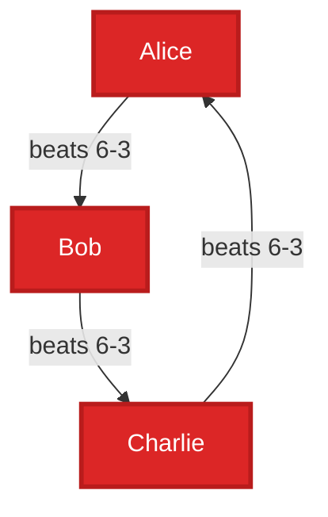

**Wait... WHAT?!** 

We have:
- Alice beats Bob
- Bob beats Charlie  
- Charlie beats Alice

This creates an impossible logical loop! It's like saying "Rock beats Scissors, Scissors beats Paper, Paper beats Rock" - which is fine for the game, but creates a paradox when we need to pick a single winner.

### 🧠 The Mathematical Impossibility

This is the famous **Condorcet Paradox**, and it reveals something profound about collective decision-making:

> **Even when every individual voter has perfectly rational, transitive preferences, the collective outcome can be completely irrational and intransitive.**

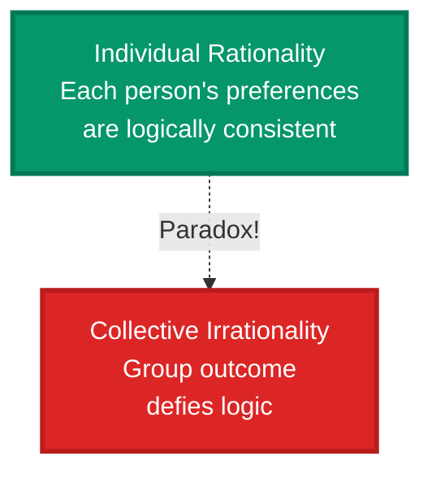

### 🛠️ How Tideman Handles the Impossible

When faced with this paradox, the Tideman algorithm doesn't throw up its hands in despair. Instead, it makes a principled choice:

1. **Sort by margin strength**: All margins are equal (6-3), so order doesn't matter much
2. **Lock systematically**: Start with the first pair and lock Alice → Bob
3. **Continue carefully**: Lock Bob → Charlie  
4. **Detect the cycle**: When we try to lock Charlie → Alice, we detect it would create a cycle
5. **Break the tie**: Skip the problematic edge, leaving Charlie → Alice unlocked

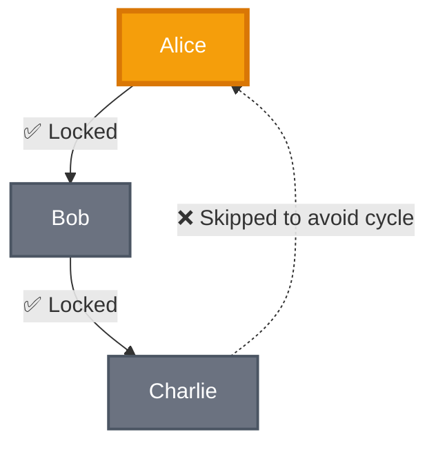

**Result**: Alice wins! Not because she's objectively the best candidate, but because the algorithm made a principled decision about how to break the logical impossibility.

This is the beauty of Tideman: it acknowledges that some voting situations are fundamentally paradoxical, and it provides a systematic, fair way to resolve them.

## 🏗️ The Engineering Challenge: Building a Robust Democracy Machine

Now comes the fun part—turning this elegant theory into bulletproof code. Building a production-quality voting system taught me that the devil truly is in the details. Let me share the technical challenges I faced and how I solved them.

### 🕵️ Challenge 1: The Cycle Detection Conundrum

The heart of the Tideman algorithm is cycle detection, and it's trickier than it first appears. How do you efficiently determine if adding a new edge to a graph will create a cycle?

#### The Problem Visualized

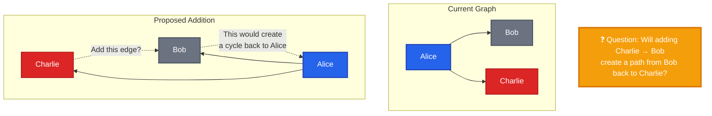

#### My Solution: Recursive Path Detection with Memoization

I implemented a recursive depth-first search that asks: "If I add this edge, can I find a path that loops back to where I started?"

```c
bool path_loser2winner_optimized(int loser, int winner, bool visited[]) {
    // Base case: if we've reached our target, we found a path!
    if (loser == winner) return true;
    
    // Optimization: avoid infinite loops with visited array
    if (visited[loser]) return false;
    
    visited[loser] = true;
    
    // Explore all outgoing edges from current node
    for (int intermediate = 0; intermediate < candidate_count; intermediate++) {
        if (locked[loser][intermediate]) {
            if (path_loser2winner_optimized(intermediate, winner, visited)) {
                return true; // Found a path!
            }
        }
    }
    return false; // No path found
}
```

#### Why This Works: Graph Theory in Action

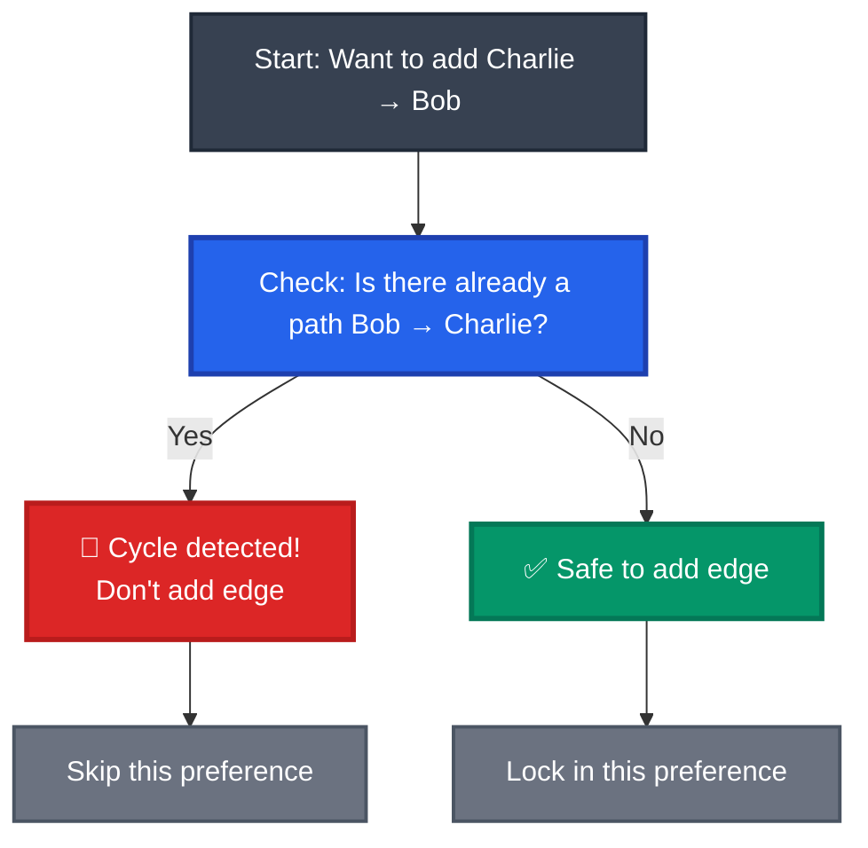

The algorithm is essentially asking: "If Charlie beats Bob, and Bob can already reach Charlie through some path, then we have a cycle." It's elegant because it reduces the complex problem of cycle detection to a simple path-finding question.

### ⚡ Challenge 2: The Performance Optimization Quest

As I started testing with larger candidate pools, I quickly discovered that the basic implementation doesn't scale well. With n candidates, the math gets scary fast:

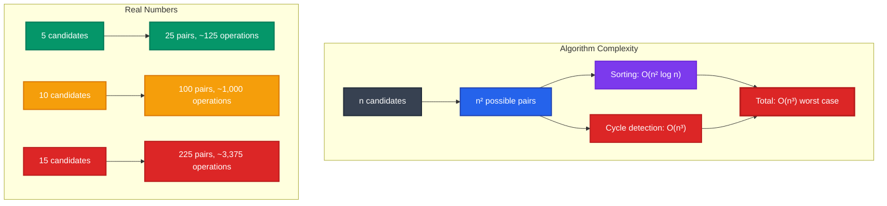

#### My Optimization Strategy

**1. Smarter Sorting**: Replaced bubble sort with merge sort
```c
// Old approach: O(n²) bubble sort
for (int i = 0; i < pair_count; i++) {
    for (int j = i + 1; j < pair_count; j++) {
        // Compare and swap
    }
}

// New approach: O(n log n) merge sort
void merge_sort_pairs(int left, int right) {
    if (left < right) {
        int mid = left + (right - left) / 2;
        merge_sort_pairs(left, mid);
        merge_sort_pairs(mid + 1, right);
        merge_pairs(left, mid, right);
    }
}
```

**2. Memoization Magic**: Cache path-finding results to avoid redundant work

**3. Early Termination**: Stop searching as soon as we find a cycle

**4. Performance Monitoring**: Track execution time and operation counts


### 🗳️ Challenge 3: Building a Voting Method Comparison Engine

One of my most ambitious goals was to transform this from a single-algorithm implementation into a comprehensive voting analysis platform. I wanted to answer the question: "How do different voting methods compare on the same data?"

#### The Democratic Menagerie: Four Different Approaches

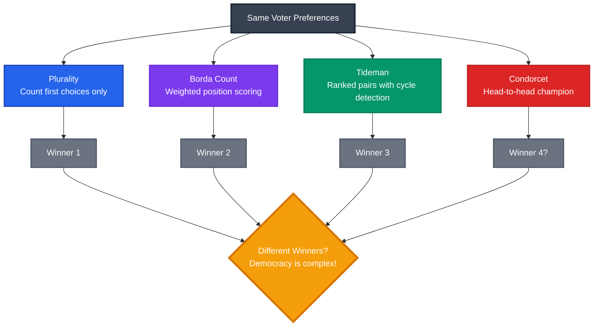

**Plurality**: The simplest approach - just count first-place votes
```c
int plurality_winner(void) {
    // Challenge: We only have pairwise data, not individual ballots
    // Solution: Estimate from preference strengths
    for (int i = 0; i < candidate_count; i++) {
        int total_strength = 0;
        for (int j = 0; j < candidate_count; j++) {
            if (i != j) total_strength += preferences[i][j];
        }
        first_place_estimate[i] = total_strength / (candidate_count - 1);
    }
}
```

**Borda Count**: Weighted scoring system (1st place = n points, 2nd = n-1, etc.)
```c
int borda_count_winner(void) {
    for (int i = 0; i < candidate_count; i++) {
        for (int j = 0; j < candidate_count; j++) {
            if (i != j) {
                borda_scores[i] += preferences[i][j];
            }
        }
    }
}
```

**Condorcet**: Find the head-to-head champion (if one exists)
```c
bool is_condorcet_winner(int candidate) {
    for (int i = 0; i < candidate_count; i++) {
        if (i != candidate && preferences[candidate][i] <= preferences[i][candidate]) {
            return false; // Lost a head-to-head matchup
        }
    }
    return true; // Beat everyone!
}
```

### 🎲 Challenge 4: Monte Carlo Election Simulation

The most exciting feature I added was the ability to run thousands of simulated elections with random voter preferences. This transforms the project from a single-election analyzer into a statistical research tool.

#### The Simulation Engine

```mermaid
flowchart TD
    Start[Start Simulation] --> Generate[Generate Random Voters]
    Generate --> Shuffle[Fisher-Yates Shuffle<br/>for each voter's preferences]
    Shuffle --> Run[Run All 4 Voting Methods]
    Run --> Record[Record Winners & Statistics]
    Record --> Loop{More Simulations?}
    Loop -->|Yes| Generate
    Loop -->|No| Analyze[Statistical Analysis]
    
    Analyze --> Results[📊 Frequency Charts<br/>📈 Agreement Rates<br/>🔍 Paradox Detection]
    
    style Start fill:#374151,stroke:#1f2937,stroke-width:2px,color:#ffffff
    style Generate fill:#2563eb,stroke:#1e40af,stroke-width:2px,color:#ffffff
    style Shuffle fill:#7c3aed,stroke:#6d28d9,stroke-width:2px,color:#ffffff
    style Run fill:#059669,stroke:#047857,stroke-width:2px,color:#ffffff
    style Record fill:#f59e0b,stroke:#d97706,stroke-width:2px,color:#ffffff
    style Loop fill:#dc2626,stroke:#b91c1c,stroke-width:3px,color:#ffffff
    style Analyze fill:#6b7280,stroke:#4b5563,stroke-width:2px,color:#ffffff
    style Results fill:#f59e0b,stroke:#d97706,stroke-width:4px,color:#ffffff
```

**The Heart of Random Democracy**: Fisher-Yates Shuffle
```c
// Generate truly random voter preferences
for (int voter = 0; voter < voter_count; voter++) {
    int ranks[MAX];
    
    // Start with ordered preferences [0, 1, 2, ...]
    for (int i = 0; i < candidate_count; i++) {
        ranks[i] = i;
    }
    
    // Shuffle using Fisher-Yates algorithm
    for (int i = candidate_count - 1; i > 0; i--) {
        int j = rand() % (i + 1);
        int temp = ranks[i];
        ranks[i] = ranks[j];
        ranks[j] = temp;
    }
    
    // Now we have a random, unbiased ranking!
}
```

#### What the Simulation Reveals

Running 10,000 elections with random voter preferences answers fascinating questions:

- **Method Agreement**: How often do Tideman and Plurality produce the same winner?
- **Paradox Frequency**: What percentage of elections have Condorcet paradoxes?
- **Competitiveness**: How close are elections on average?
- **Fairness**: Does any method systematically favor certain types of candidates?

```mermaid
pie title "Simulation Results Example (1000 elections)"
    "Tideman equals Plurality" : 650
    "Tideman differs from Plurality" : 350
```

## 🚀 The Complete Democracy Platform: Advanced Features

What started as a basic algorithm implementation evolved into a comprehensive election analysis platform. Here are the advanced features that make this system truly special:

### 1. 📊 Comprehensive Analytics Dashboard

Every election generates a wealth of insights:

```mermaid
graph TD
    Election[Election Data] --> Stats[Statistical Analysis]
    Stats --> H2H[Head-to-Head Records]
    Stats --> Scores[Condorcet Scores]
    Stats --> Comp[Competitiveness Rating]
    Stats --> Paradox[Paradox Detection]
    
    H2H --> Dashboard[Analytics Dashboard]
    Scores --> Dashboard
    Comp --> Dashboard
    Paradox --> Dashboard
    
    style Election fill:#374151,stroke:#1f2937,stroke-width:2px,color:#ffffff
    style Stats fill:#2563eb,stroke:#1e40af,stroke-width:3px,color:#ffffff
    style H2H fill:#7c3aed,stroke:#6d28d9,stroke-width:2px,color:#ffffff
    style Scores fill:#059669,stroke:#047857,stroke-width:2px,color:#ffffff
    style Comp fill:#dc2626,stroke:#b91c1c,stroke-width:2px,color:#ffffff
    style Paradox fill:#f59e0b,stroke:#d97706,stroke-width:2px,color:#ffffff
    style Dashboard fill:#f59e0b,stroke:#d97706,stroke-width:4px,color:#ffffff
```

The system calculates:
- **Head-to-head win/loss records** for each candidate
- **Condorcet scores** (percentage of pairwise matchups won)
- **Election competitiveness** on a 0-10 scale
- **Margin analysis** with victory percentages
- **Automatic paradox detection** with explanations

### 2. 🎨 Professional Visualization Engine

Gone are the days of plain text output. The system produces beautiful, Unicode-styled results:

```
╔════════════════════════════════════════════════════════════════════════════════════════╗
║                              ELECTION RESULTS                                         ║
╚════════════════════════════════════════════════════════════════════════════════════════╝

🏆 TIDEMAN WINNER: Alice

═══ LOCKED PAIRS GRAPH ═══
Alice → Bob (margin: 1)
Alice → Charlie (margin: 5)

═══ PREFERENCE MATRIX ═══
         Alice  Bob  Charlie
Alice      -     5      7
Bob        4     -      6  
Charlie    2     3      -
```

### 3. 💾 Enterprise-Grade Data Persistence

Elections can be saved and loaded with a structured file format:
```
ELECTION_DATA
Student Council Election 2025
2025-09-25
3
9
Alice
Bob  
Charlie
[preference matrix data...]
```

This enables:
- **Historical analysis** of past elections
- **Collaboration** - share election data between researchers
- **Reproducibility** - verify results independently
- **Archival** - preserve important election data

### 4. 🖥️ Multi-Modal User Interface

The system supports multiple interaction paradigms:

```mermaid
flowchart LR
    User[User] --> CLI[Command Line<br/>./tideman Alice Bob Charlie]
    User --> Interactive[Interactive Mode<br/>Menu-driven interface]
    User --> Files[File Operations<br/>Load/save elections]
    User --> Demo[Demo Mode<br/>Automated testing]
    
    CLI --> Results[Election Results]
    Interactive --> Results
    Files --> Results
    Demo --> Results
    
    style User fill:#374151,stroke:#1f2937,stroke-width:3px,color:#ffffff
    style CLI fill:#2563eb,stroke:#1e40af,stroke-width:2px,color:#ffffff
    style Interactive fill:#7c3aed,stroke:#6d28d9,stroke-width:2px,color:#ffffff
    style Files fill:#059669,stroke:#047857,stroke-width:2px,color:#ffffff
    style Demo fill:#dc2626,stroke:#b91c1c,stroke-width:2px,color:#ffffff
    style Results fill:#f59e0b,stroke:#d97706,stroke-width:4px,color:#ffffff
```

## 🎓 The Learning Journey: From Code to Democracy

This project became far more than a programming exercise—it was a deep dive into the intersection of computer science, mathematics, and political theory. Here's what I discovered along the way:

### 💻 Computer Science Mastery

```mermaid
graph TD
    Root["CS Concepts"] --> GT["Graph Theory"]
    Root --> AD["Algorithm Design"]
    Root --> DS["Data Structures"]
    Root --> SE["Software Engineering"]
    
    GT --> CD["Cycle Detection"]
    GT --> TS["Topological Sorting"]
    GT --> PF["Path Finding"]
    
    AD --> CA["Complexity Analysis"]
    AD --> Opt["Optimization"]
    AD --> PM["Performance Monitoring"]
    
    DS --> MO["Matrix Operations"]
    DS --> MM["Memory Management"]
    DS --> ES["Efficient Storage"]
    
    SE --> MD["Modular Design"]
    SE --> EH["Error Handling"]
    SE --> UX["User Experience"]
    
    style Root fill:#374151,stroke:#1f2937,stroke-width:4px,color:#ffffff
    style GT fill:#2563eb,stroke:#1e40af,stroke-width:3px,color:#ffffff
    style AD fill:#7c3aed,stroke:#6d28d9,stroke-width:3px,color:#ffffff
    style DS fill:#059669,stroke:#047857,stroke-width:3px,color:#ffffff
    style SE fill:#dc2626,stroke:#b91c1c,stroke-width:3px,color:#ffffff
```

- **Graph Algorithms**: Mastered cycle detection, learned that graphs aren't just academic—they model real democratic relationships
- **Performance Optimization**: Discovered that algorithmic efficiency matters when you're processing thousands of elections
- **Software Architecture**: Built a system that's both powerful and user-friendly

### 🗳️ Democratic Theory Revelations

The most fascinating discoveries were about democracy itself:

- **Arrow's Impossibility Theorem**: Kenneth Arrow proved mathematically that no voting system can satisfy all desirable properties simultaneously. Democracy is fundamentally about trade-offs.

- **Condorcet Criterion**: Sometimes the "will of the people" creates logical paradoxes. Individual rationality doesn't guarantee collective rationality.

- **Strategic Voting**: Voters might have incentives to vote dishonestly. The design of voting systems affects human behavior.

- **Social Choice Theory**: Math can illuminate the deepest questions about fairness, representation, and collective decision-making.

### 🌍 Real-World Impact and Applications

This isn't just theoretical—these concepts matter in the real world:

```mermaid
graph TD
    Theory[Voting Theory] --> ER[Electoral Reform<br/>Ranked-choice voting adoption]
    Theory --> Corp[Corporate Governance<br/>Better committee decisions]
    Theory --> AI[AI Systems<br/>Aggregating multiple inputs]
    Theory --> Social[Social Platforms<br/>Recommendation algorithms]
    
    style Theory fill:#374151,stroke:#1f2937,stroke-width:4px,color:#ffffff
    style ER fill:#2563eb,stroke:#1e40af,stroke-width:3px,color:#ffffff
    style Corp fill:#7c3aed,stroke:#6d28d9,stroke-width:3px,color:#ffffff
    style AI fill:#059669,stroke:#047857,stroke-width:3px,color:#ffffff
    style Social fill:#dc2626,stroke:#b91c1c,stroke-width:3px,color:#ffffff
```

- **Electoral Reform**: Cities and states are adopting ranked-choice voting—understanding these algorithms helps evaluate policy proposals
- **Corporate Decision-Making**: Better methods for board decisions and group consensus
- **AI and Machine Learning**: Techniques for aggregating multiple models or opinions
- **Platform Design**: How social media algorithms aggregate user preferences

## 🏆 Project Impact: From Assignment to Research Platform

### 📈 Technical Achievements by the Numbers

```mermaid
graph LR
    Start[Original CS50<br/>~250 lines] --> Enhanced[Enhanced System<br/>1,300+ lines]
    
    Enhanced --> Features[15+ Major Features]
    Enhanced --> Methods[4 Voting Methods]
    Enhanced --> Sim[Monte Carlo Simulation]
    Enhanced --> Perf[Performance Optimization]
    
    style Start fill:#6b7280,stroke:#4b5563,stroke-width:2px,color:#ffffff
    style Enhanced fill:#f59e0b,stroke:#d97706,stroke-width:4px,color:#ffffff
    style Features fill:#2563eb,stroke:#1e40af,stroke-width:3px,color:#ffffff
    style Methods fill:#7c3aed,stroke:#6d28d9,stroke-width:3px,color:#ffffff
    style Sim fill:#059669,stroke:#047857,stroke-width:3px,color:#ffffff
    style Perf fill:#dc2626,stroke:#b91c1c,stroke-width:3px,color:#ffffff
```

**Scale of Transformation:**
- **5x code expansion**: From 250 to 1,300+ lines
- **15+ major features** added beyond basic requirements
- **4 voting methods** implemented and compared
- **Professional UI** with Unicode styling and comprehensive error handling
- **Research-grade simulation** capability with statistical analysis
- **Enterprise features**: File I/O, data persistence, performance monitoring

### 🎯 Why This Project Matters in the Real World

This isn't just an academic exercise—it addresses fundamental questions about democracy that affect millions of people:

```mermaid
flowchart TD
    Algorithm[Tideman Algorithm] --> Understanding[Deep Understanding of Democracy]
    Understanding --> Applications[Real-World Applications]
    
    Applications --> RCV[Ranked-Choice Voting<br/>NYC, Maine, Alaska adoption]
    Applications --> Corporate[Corporate Governance<br/>Better board decisions]
    Applications --> Tech[Tech Platforms<br/>Recommendation systems]
    Applications --> Policy[Policy Analysis<br/>Electoral reform research]
    
    style Algorithm fill:#374151,stroke:#1f2937,stroke-width:3px,color:#ffffff
    style Understanding fill:#f59e0b,stroke:#d97706,stroke-width:4px,color:#ffffff
    style Applications fill:#2563eb,stroke:#1e40af,stroke-width:3px,color:#ffffff
    style RCV fill:#059669,stroke:#047857,stroke-width:2px,color:#ffffff
    style Corporate fill:#059669,stroke:#047857,stroke-width:2px,color:#ffffff
    style Tech fill:#059669,stroke:#047857,stroke-width:2px,color:#ffffff
    style Policy fill:#059669,stroke:#047857,stroke-width:2px,color:#ffffff
```

**Current Real-World Relevance:**
- **Electoral Reform**: New York City, Maine, and Alaska have adopted ranked-choice voting
- **Corporate Governance**: Companies are exploring better decision-making mechanisms
- **AI Ethics**: How do we fairly aggregate multiple AI model outputs?
- **Platform Democracy**: How should social media platforms rank and recommend content?

## 🌟 The Bigger Picture: Computational Democracy

This project represents something larger than any single algorithm—it's about using computational thinking to understand and improve democratic processes.

### 🧠 Key Insights That Changed My Perspective

**1. Democracy is a Design Problem**
Just like software systems, voting methods have trade-offs. There's no perfect solution, only different approaches with different strengths and weaknesses.

**2. Mathematics Illuminates Politics**
Seemingly abstract math concepts like graph theory and combinatorics directly impact how societies make collective decisions.

**3. Code Can Explore Ideas**
Programming isn't just about building products—it's a tool for exploring complex theoretical questions and testing hypotheses.

**4. Interdisciplinary Thinking Matters**
The most interesting problems exist at the intersection of multiple fields. This project required computer science, mathematics, political theory, and user experience design.

## 🚀 Looking Forward: Future Possibilities

The foundation I've built opens doors to exciting extensions:

```mermaid
graph TD
    Current[Current System] --> Web[Web Application<br/>Interactive democracy platform]
    Current --> Research[Research Tool<br/>Academic voting theory study]
    Current --> Education[Educational Platform<br/>Teaching democratic concepts]
    Current --> Consulting[Policy Consulting<br/>Electoral reform analysis]
    
    Web --> Global[Global Democracy<br/>International studies]
    Research --> Papers[Academic Publications<br/>Voting theory research]
    Education --> Curriculum[University Courses<br/>Computational social choice]
    Consulting --> Reform[Real Electoral Reform<br/>Evidence-based policy]
    
    style Current fill:#f59e0b,stroke:#d97706,stroke-width:4px,color:#ffffff
    style Web fill:#2563eb,stroke:#1e40af,stroke-width:2px,color:#ffffff
    style Research fill:#7c3aed,stroke:#6d28d9,stroke-width:2px,color:#ffffff
    style Education fill:#059669,stroke:#047857,stroke-width:2px,color:#ffffff
    style Consulting fill:#dc2626,stroke:#b91c1c,stroke-width:2px,color:#ffffff
    style Global fill:#6b7280,stroke:#4b5563,stroke-width:2px,color:#ffffff
    style Papers fill:#6b7280,stroke:#4b5563,stroke-width:2px,color:#ffffff
    style Curriculum fill:#6b7280,stroke:#4b5563,stroke-width:2px,color:#ffffff
    style Reform fill:#6b7280,stroke:#4b5563,stroke-width:2px,color:#ffffff
```

## 🎓 Final Reflection: The Power of Curiosity-Driven Learning

What began as a simple CS50 assignment taught me that the most meaningful learning happens when you follow your curiosity beyond the requirements. By asking "What if?" and "How else could this work?", I transformed a basic algorithm implementation into a comprehensive exploration of computational democracy.

**The Meta-Lesson**: Great projects aren't just about the destination—they're about the intellectual journey. This project taught me as much about learning itself as it did about voting theory or algorithm design.

**For Future Builders**: Don't just complete assignments—interrogate them. Ask deeper questions. Build beyond the requirements. Some of the most important problems in computer science exist at the boundaries between disciplines.

---

*This project demonstrates that code isn't just about computers—it's about using computational thinking to understand and improve the world around us. In an era where technology increasingly shapes democracy, understanding these connections isn't just academically interesting—it's essential for building a better future.*

### 🔗 Want to Explore More?

- **Try the system**: `./tideman Alice Bob Charlie`
- **Run simulations**: `./tideman -i` → Option 3
- **Analyze real data**: Load your own election scenarios
- **Extend the research**: Fork the project and add your own voting methods

The intersection of computation and democracy is rich with unexplored possibilities. What will you discover?
